# tasklane

An open source issue and project tracker built for feature parity with Jira, written in Go: a **drop-in replacement for
Jira** that you run yourself, for one team or for many.

Tasklane gives teams the parts of Jira they actually use - boards, backlogs, weekly sprints, rich ticket views,
custom fields, workflows - without the weight, and with the enterprise basics (SSO, audit, permissions) built in.

## What it is

- **A replacement for Jira, not a lookalike.** The same vocabulary (project, issue type, workflow, sprint, epic, filter), a
  JQL-compatible query language (TQL), keys that look like Jira's (`ABC-123`) and keep working after a move, and a way
  in: import a Jira project, or run a read-only one-way mirror of your Jira site while you switch. Boards, backlogs,
  sprints, custom fields, workflows, automation, approvals, a customer portal, dashboards and releases are built.
  What is *not* there yet: the Jira REST API under `/rest/api/3` (tools written against Jira's API need a small
  adaptation; Tasklane has its own documented REST API, webhooks and an MCP server for agents) and write-back to Jira.
- **Many sites on one installation.** An installation can serve several **organizations**, each a separate tenant
  with its own people, projects, administrators, security policy and mail domain, and nothing visible across the line
  (enforced by the database, not only by the application: [docs/ORGANIZATIONS.md](docs/ORGANIZATIONS.md)). A
  deployment can be pinned to a region, and several nodes can serve one installation behind a load balancer, with rolling
  upgrades ([docs/CLUSTER.md](docs/CLUSTER.md), [docs/UPGRADE.md](docs/UPGRADE.md)).
- **Access rights management.** Roles per project (viewer, member, admin) and custom roles, groups, a permission scheme per
  project, organization administrators who administer their own organization only, and per-organization security
  policy (second factor required, network allow-list, session length, allowed e-mail domains). People sign in with a
  password, a second factor (authenticator app or passkey), or single sign-on (OpenID Connect, SAML, LDAP and Active
  Directory); accounts can be provisioned by SCIM; every administrative change goes to a tamper-evident audit log
  ([docs/PERMISSIONS.md](docs/PERMISSIONS.md), [docs/IDENTITY.md](docs/IDENTITY.md), [docs/AUDIT.md](docs/AUDIT.md)).
- **Billing support for a hosted service.** Switched on with `hosted=true`: a plan per organization (seats, projects,
  storage, enforced by the database), usage metering, prices, and a monthly invoice per organization made on
  schedule and delivered to your billing system by a signed webhook, with announced maintenance windows and support levels
  ([docs/HOSTED.md](docs/HOSTED.md)). Tasklane prices and invoices what was used; it does not take payment, calculate tax
  or draw PDFs. Off by default, and a self-hosted installation has none of it: no limits, no licence keys, no calls home.

## Quick start

Tasklane runs as two containers, Tasklane and PostgreSQL, with Docker Compose. You need Docker with the Compose plugin
(`docker compose version`), `git`, `curl`, `jq` and `openssl`. If your user cannot run Docker, use
`sudo --preserve-env docker …`, so the variables you export still reach Compose.

### 1. Clone

```bash
git clone https://github.com/larytet/tasklane.git
cd tasklane/deploy/compose
```

### 2. Set the variables

Compose reads `deploy/compose/.env`. Generate the secrets once and keep the file private:

```bash
umask 077
cat > .env <<END
TASKLANE_DB_PASSWORD=$(openssl rand -hex 16)
TASKLANE_ADMIN_EMAIL=you@example.com
TASKLANE_ADMIN_PASSWORD=$(openssl rand -base64 18 | tr -d '/+=')
TASKLANE_BASE_URL=http://$(hostname -I | awk '{print $1}'):8080
END
grep ADMIN .env    # the administrator you will sign in as
```

| Variable | Meaning |
|---|---|
| `TASKLANE_DB_PASSWORD` | PostgreSQL password (required) |
| `TASKLANE_ADMIN_EMAIL`, `TASKLANE_ADMIN_PASSWORD` | the first administrator. It is created at the first start only, so changing these later does nothing; change the password on the Account page instead. |
| `TASKLANE_BASE_URL` | the address people use; sign-in redirects and links in mail point here |
| `TASKLANE_SSO_ALLOW_PRIVATE` | `true` lets Tasklane reach identity providers on private addresses. LDAP domain controllers almost always are. Set it in `.env` or export it. |

`docker compose run --rm tasklane config docs` lists every other setting.

### 3. Build and start

```bash
export TASKLANE_SSO_ALLOW_PRIVATE=true      # needed for LDAP (step 5)
docker compose up -d --build
curl -s -o /dev/null -w '%{http_code}\n' http://localhost:8080/readyz   # 200 when ready
```

Open `TASKLANE_BASE_URL` in a browser and sign in with the administrator from `.env`.

The first start creates the database schema. A later release that changes the schema refuses to start until you migrate;
the log says `the database schema (version N) is behind this release`. Migrating is always an explicit step:

```bash
git pull
docker compose build tasklane
docker compose run --rm tasklane migrate
docker compose up -d
```

### 4. Collect the directory settings

LDAP sign-in lets people use their Active Directory (or OpenLDAP) name and password on the ordinary sign-in form. Ask
your directory administrator for these values. Export them in the shell you work in, for example in `~/.bashrc`:

```bash
export LDAP_SERVERS='dc1.corp.example.com'                     # one name, or several separated by commas
export LDAP_BIND_DN='CN=svc-tasklane,OU=Service Users,DC=corp,DC=example,DC=com'   # the account that searches
export LDAP_BIND_PASSWORD='...'                                # single quotes keep $ ! ` \ intact
export LDAP_USER_SEARCH='OU=Users,DC=corp,DC=example,DC=com'   # where people are searched for
```

Check the search account before involving Tasklane. This needs `ldap-utils` (Debian, Ubuntu) or `openldap-clients`.
`LDAPTLS_REQCERT=never` is only needed when you do not have the directory's CA certificate.

```bash
printf %s "$LDAP_BIND_PASSWORD" > /tmp/.ldappw && chmod 600 /tmp/.ldappw
LDAPTLS_REQCERT=never ldapwhoami -x -H "ldaps://${LDAP_SERVERS%%,*}" -D "$LDAP_BIND_DN" -y /tmp/.ldappw
rm -f /tmp/.ldappw
```

- `u:CORP\svc-tasklane` means the account works.
- `Invalid credentials (49) ... data 52e` means the password is wrong for that DN.

### 5. Create the LDAP provider

In the browser: **Admin → Identity → Add a provider → Protocol: LDAP (Active Directory)**.

1. Enter a name (`corp-ad`) and a label.
2. **Server addresses:** `ldaps://dc1.corp.example.com`, or `ldap://…` with *StartTLS* ticked. Several addresses are tried in
   order.
3. **Certificate:** paste the directory's CA certificate, or tick *Do not verify the server certificate* if you do not have it.
4. **Search account and base:** fill in the search account DN, its password and the base DN.
5. **User filter:** leave it empty for the Active Directory default. The default matches the name typed against
   `sAMAccountName`, `userPrincipalName`, `uid` or `mail`. To let only one group sign in, see
   [docs/IDENTITY.md](docs/IDENTITY.md).
6. **Optional:** limit sign-in to some email domains, and choose whether accounts are created at first sign-in.
7. **Test:** save, open the provider again (*Edit*) and use **Try a sign-in** with your own name and password. It shows the
   entry found, the address, and whether the account exists or would be created. It signs nobody in.

The same steps from the shell, run in `deploy/compose` so `.env` supplies the administrator:

```bash
set -a; . ./.env; set +a
T=http://localhost:8080; J=$(mktemp)
H=(-H 'Content-Type: application/json' -H 'X-Requested-With: tasklane')
jq -n --arg e "$TASKLANE_ADMIN_EMAIL" --arg p "$TASKLANE_ADMIN_PASSWORD" '{email:$e,password:$p}' |
  curl -s -c "$J" "${H[@]}" -d @- -o /dev/null -w 'sign-in %{http_code}\n' $T/api/v1/login
URLS=$(echo "$LDAP_SERVERS" | tr ',' '\n' | sed 's/^ *//; s|^|ldaps://|' | paste -sd' ')
jq -n --arg urls "$URLS" --arg dn "$LDAP_BIND_DN" --arg pw "$LDAP_BIND_PASSWORD" --arg base "$LDAP_USER_SEARCH" \
  '{protocol:"ldap", name:"corp-ad", label:"Corporate directory", issuer:$urls, ldap_skip_verify:true,
    ldap_bind_dn:$dn, client_secret:$pw, ldap_base_dn:$base, jit:true, enabled:true}' |
  curl -s -b "$J" "${H[@]}" -d @- $T/api/v1/admin/sso/providers | tee /tmp/prov.json | jq '{id, issuer, secret_set, error}'
ID=$(jq .id /tmp/prov.json); rm -f /tmp/prov.json
# try your own account: nobody is signed in
read -rp 'name: ' U; read -rsp 'password: ' P; echo
jq -n --arg l "$U" --arg p "$P" '{login:$l,password:$p}' |
  curl -s -b "$J" "${H[@]}" -d @- $T/api/v1/admin/sso/providers/$ID/check | jq
rm -f "$J"
```

### 6. Sign in with the directory

Sign out, then sign in with `jana.k`, `CORP\jana.k` or `jana.k@corp.example.com` and the directory password.

- The first sign-in creates the account. An existing account with the same address is used instead.
- A second factor is still asked for when the account has one.
- Five failures lock the name for fifteen minutes before anything reaches the directory.
- The local administrator keeps working beside the directory.

When sign-in fails, *Try a sign-in* says why, and the server log names the provider and the reason
(`docker compose logs tasklane`). Details are in [docs/IDENTITY.md](docs/IDENTITY.md).

**Optional: mirror a Jira Cloud project.** A read-only copy gives a fast UI over Jira data; see [docs/JIRA.md](docs/JIRA.md).

## Design stance

- **Dark mode first.** Dark is the default and reference theme; light is derived from the same tokens.
- **Gmail-compact ticket reading.** A ticket is a thread: compact message rows, collapsed history, an attachment chip
  strip, a sticky reply bar. Reading a ticket and its attachments needs nothing else on screen.
- **Management in dedicated tabs.** Workflows, fields, schemes, permissions and SSO live in Admin tabs, out of the way.

- **Safe concurrent editing, without locks.** Anyone can edit at any time. You see who else is editing a field, drafts are autosaved
  so nothing typed is lost, and a save that would overwrite someone else's change opens a merge dialog instead of clobbering it.
- **Built for agents.** A built-in MCP server lets AI coding agents pick up tickets, report progress, link PRs and hand
  work to a human for review, under the same permissions and audit as people.
- **A native Android app.** Sign in (with a second factor if your account has one), search and browse issues, read boards
  and the inbox, and comment, from a phone, against the same REST API. Light and dark. See [android/](android/README.md).

## What it looks like

- **Board** - Scrum and Kanban boards with swimlanes, quick filters, drag and drop between workflow columns, WIP limits.
- **Backlog** - ranked list with sprint panels, drag to plan, story point totals per sprint.
- **Sprints** - weekly cadence by default, auto-created and auto-rolled, burndown and velocity. The week follows your work
  calendar (Monday to Friday, Sunday to Thursday, or custom start day, working days and holidays).
- **Ticket view** - full page and side-panel layout: summary, description, custom fields, subtasks, links, comments,
  activity, attachments, time tracking, watchers.
- **Search** - plain search (`Alan AND (Arkady OR Dana) -draft`, also matching people) or a query language (TQL, JQL-compatible subset), saved filters, list and table views, bulk edit.
- **Dashboards** - gadgets backed by saved filters.
- **Admin** - projects, workflows, schemes, custom fields, permissions, SSO, audit log.

## Screenshots

Real screenshots of a running server with a small demo project, not mockups. Shots are in dark mode (the
reference theme), with one light-theme shot for the web UI and one for the Android app. Tokens, type and spacing are in
[DESIGN.md](DESIGN.md).

### Web

**Issue list.** Search box with plain text and TQL, bulk select, density and column controls.

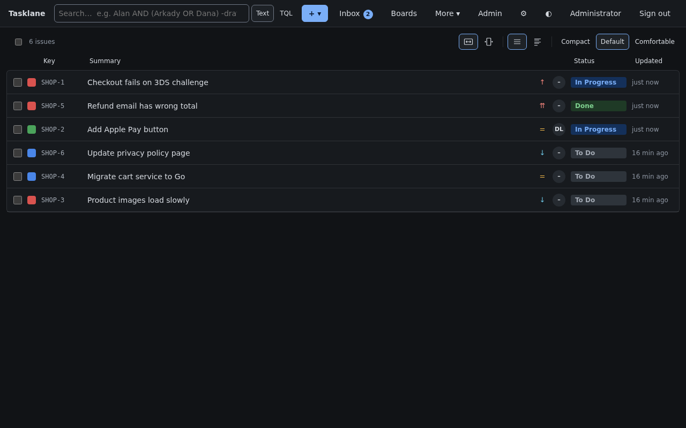

**Ticket as a thread.** Comments, history and fields side by side, a sticky reply bar, and a watch toggle.

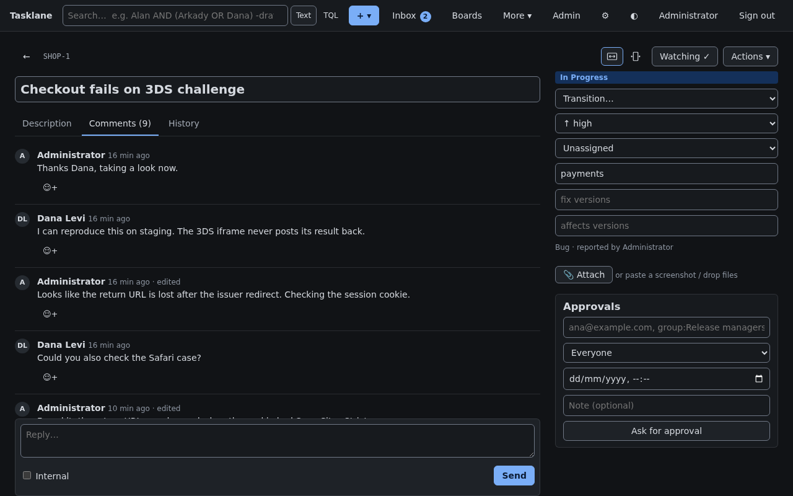

**Conflict dialog.** Two people saved the same description: their changes, your changes and an editable merged result,
with the block both of you changed called out. Keeping yours never destroys theirs; it stays in history and can be
restored. The banner at the top right shows who else is on the ticket.

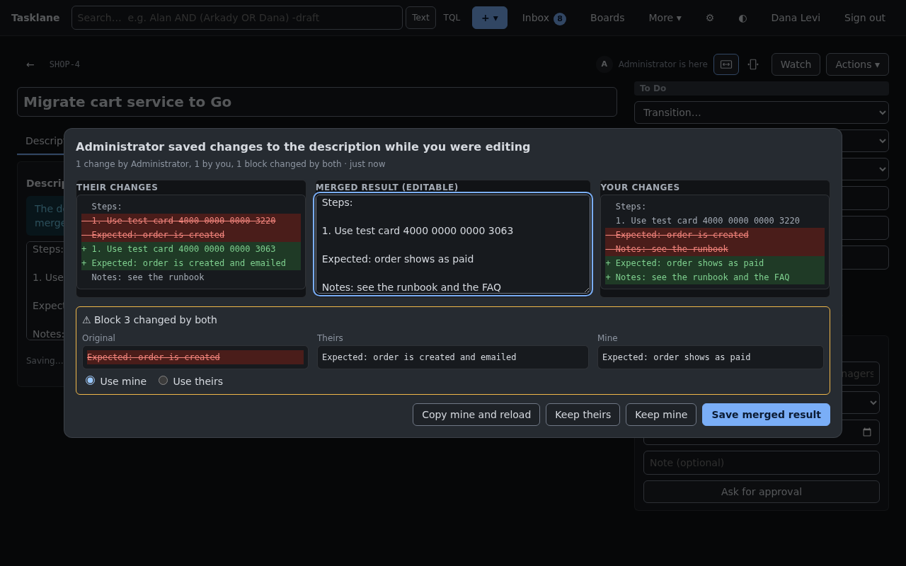

**Board.** Columns from the workflow, cards with priority, assignee and estimate; a "Move to" control on every card
(drag and drop works too).

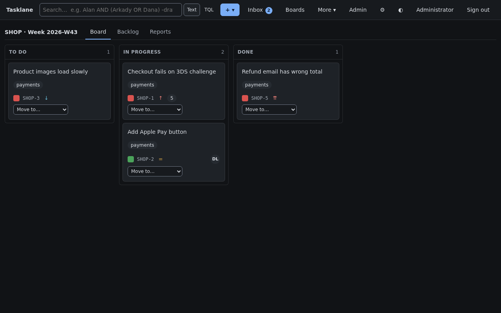

**Backlog and weekly sprints.** The active sprint with its goal and progress, future sprints created automatically,
and the rest of the backlog below.

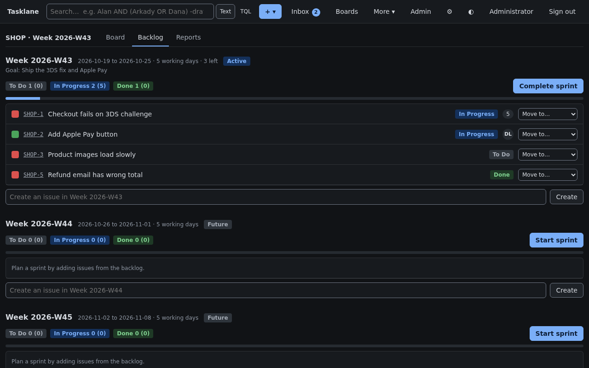

**Light theme.**

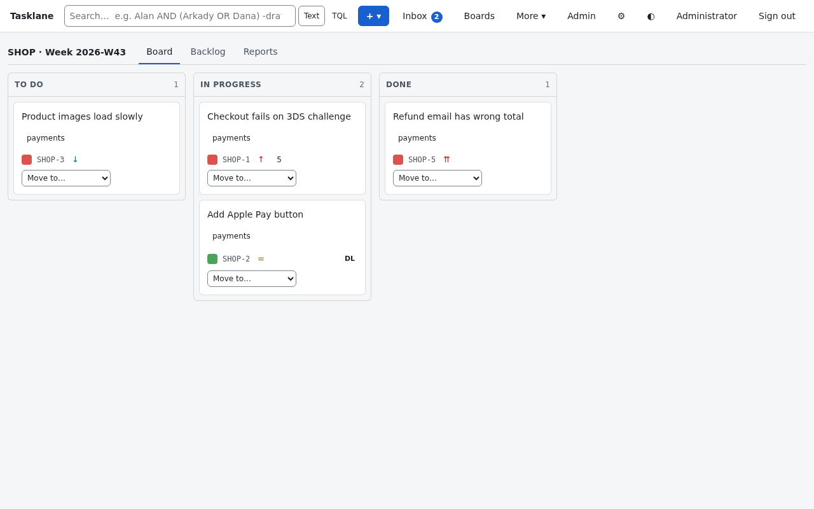

### Android

A native app (Kotlin, Jetpack Compose) for reading and commenting from a phone: sign in, search, open an issue, read a
board column by column, check the inbox. It follows the device's day and night setting. See
[android/README.md](android/README.md) for what it does and how to build it.

<table>
<tr>
<td align="center">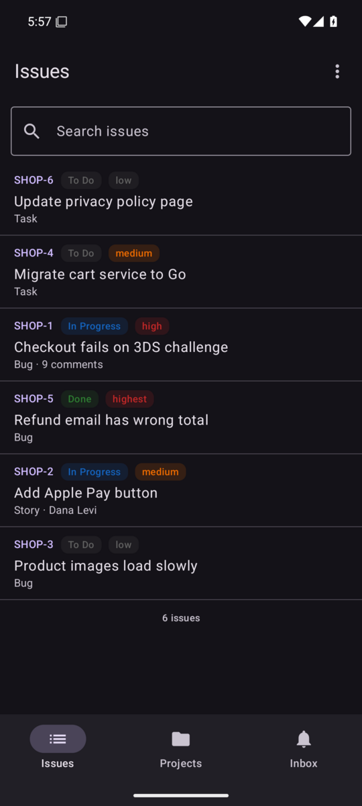<br><sub>Issues</sub></td>
<td align="center">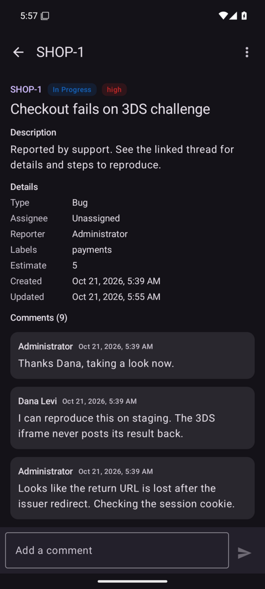<br><sub>Issue</sub></td>
<td align="center">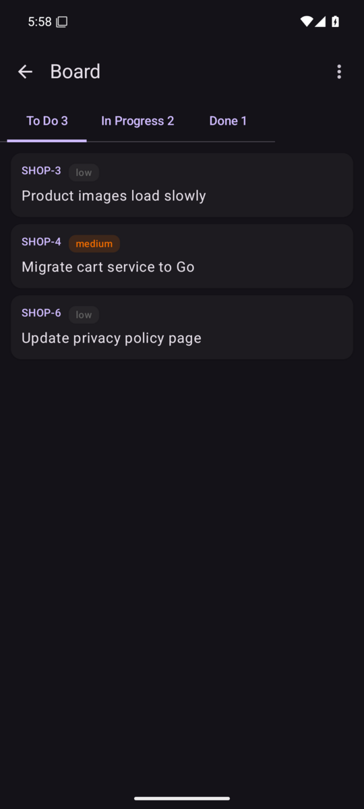<br><sub>Board</sub></td>
<td align="center">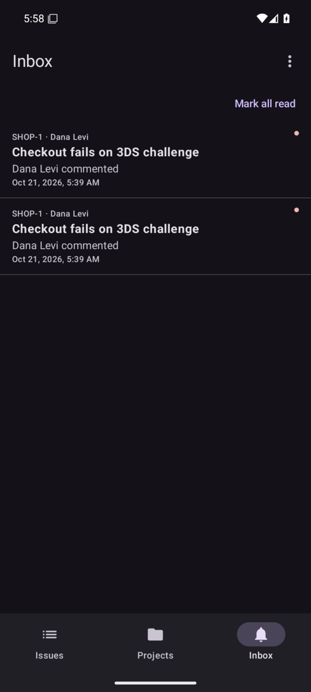<br><sub>Inbox</sub></td>
<td align="center">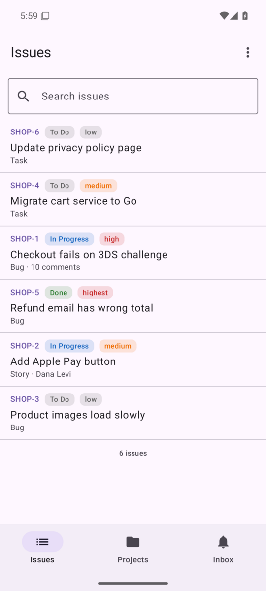<br><sub>Light theme</sub></td>
</tr>
</table>

## Goals

- Familiar to anyone who has used Jira: same vocabulary (project, issue type, workflow, sprint, epic, filter).
- A single Go binary plus PostgreSQL; one install, one command. No JVM, no plugins runtime required to get started.
- Custom fields and workflows are data, not code: admins change them in the UI with no deploy.
- Work with Jira, not instead of it at first: a read-only, one-way mirror of Jira into Tasklane gives a fast UI over your
  Jira data (edits stay in Jira), and the same machinery imports a project when you are ready to switch. Export to Jira is by
  CSV; write-back to Jira is a later add-on.
- Open exchange formats: a JSON bundle and a CSV bundle for the full project, plus basic importers for GitHub Issues,
  Trello, Linear, Asana and generic CSV. No lock-in.
- Email in and out: threaded notifications, reply by email, create issues by email, with spoofing and loop protection.
- A real issue lifecycle: custom workflows, convert, move (old keys keep working), clone, trash and restore.
- Install with a container, Compose, Helm or a tarball; documented configuration; rolling upgrades; no license keys.

## Status

Built and tested, and in use on a test installation; not yet released as 1.0. What exists against what is still open
is kept in [STATUS.md](STATUS.md) (milestones, the issues found on the way and how each was resolved) and
[TESTPLAN.md](TESTPLAN.md) (every test and what it covers); the specification is [SPEC.md](SPEC.md) and the design is
[DESIGN.md](DESIGN.md).

| Area | State |
|---|---|
| Tracker, workflows, custom fields, boards, backlog, sprints, dashboards, releases, approvals, automation, customer portal | built |
| Lifecycle (convert, move, clone, trash, bulk jobs), import and export (JSON and CSV bundles; Jira, GitHub Issues, Trello, Linear, Asana and generic CSV in), Jira mirror (read-only, one way) | built |
| Sign-in (password, second factor, passkeys, OpenID Connect, SAML, LDAP), SCIM, roles, groups, permission schemes, audit log, privacy export and erasure | built |
| Organizations (tenants), hosted edition with plans, metering and invoices | built |
| E-mail in and out, Git integration (GitHub and GitLab, read-only), MCP server for agents | built |
| Android app (Kotlin, Jetpack Compose): sign-in, browse, search, boards, inbox, comments | built, read and comment only; editing, creating and moving issues, passkey sign-in and push are not built |
| Several nodes, Redis or Valkey event bus, OpenSearch, S3 storage, rolling upgrades, backup and restore, Helm chart | built |
| Jira REST API under `/rest/api/3`, write-back to Jira | not built |
| The editor on the rich-text model (the converters between Markdown, Jira's document format and the model are built and tested; the page still edits plain text) | partly built |
| Payment, tax and PDF invoices | not built (out of scope: Tasklane hands invoices to your billing system) |

How it was tested: about 90 browser tests and a Go suite that runs against real PostgreSQL; a compose setup with two nodes
on real PostgreSQL, Redis and OpenSearch; rolling upgrades under load, network faults and clock skew on real binaries; and a
reliability campaign of 2.9 million saves and 1.6 million editing sessions with no lost, duplicated or stale save and no
lost draft. That is about 1% of the saves and half of the sessions the specification asks for, so its 1-in-10^8 and
1-in-10^9 error targets are not yet demonstrated, only that no error occurred at this size.

## Stack

- Go (API server, workers), PostgreSQL, optional OpenSearch (an additional service) for search at scale
- REST API (Tasklane's own; a Jira-compatible subset under `/rest/api/3` is planned, not built), webhooks and an MCP server
- Web UI: server-delivered SPA
- Android app: Kotlin, Jetpack Compose, Material 3, OkHttp (`android/`); talks to the same REST API

## Related projects

- [Windshift](https://github.com/Windshiftapp/core) - an open source, self-hosted work management platform written in Go
  (AGPL-3.0), covering boards, sprints, workflows, a customer portal, time tracking and test management.

## License

Apache-2.0 (proposed, to be confirmed before the first public release; see SPEC section 17.9).
